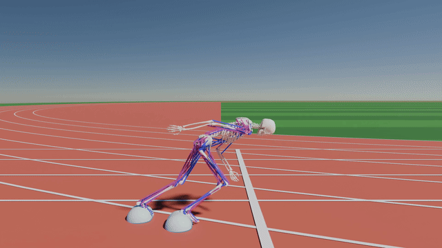

<h2>
<br>RL Environments for Musculoskeletal Simulations
</h2>

RL environments built on top of the [Bolt](https://github.com/willwng/bolt) simulator that run entirely on the GPU.

<div float="center">
  
</div>

## Preqrequisites/Setup
Requires installation of [Bolt](https://github.com/willwng/bolt) (instructions can be found in the README).

Rest of packages (required for training and visualization):
```bash
cd "path to msk_envs"
pip install -r requirements.txt
```

## Training
We provide example training code based on [FastTD3](https://github.com/younggyoseo/FastTD3), [QFlex](https://github.com/LNSGroup/Qflex), SAC, and PPO (see [Holosoma](https://github.com/amazon-far/holosoma/tree/main)), including hyperparameters for the example environments.

To start a training run, use the corresponding config (found in [hyperparams](msk_envs/train/hyperparams.py)):

```bash
python -m msk_envs.train.train [sprint|vertical|...] --exp_prefix my_training_run --algo td3 env_config:sprinter
```

*Note that `env-config.*` parameters must be set at the end*

## Trajectory visualization
We provide visualization tools as well as scripts to generate analytics of trajectories (as PDFs).
### Dashboard (web-viewer)
<div float="center">
  
</div>

During training, every `eval_freq` steps, the training script will save a 
checkpoint and a trajectory JSON (in `dashboard/trajectories/<experiment>`). These trajectories can be
visualized with the web-viewer at http://localhost:8000:
```bash
python dashboard/dashboard.py
```
Use `--traj-dir` to view trajectories elsewhere, `--port` to serve on another port, and `--geometry-dir` to point at
Bolt's meshes when Bolt is not installed.

#### Visualize from remote

First, mount the remote traj dir to your local machine

```bash
sshfs remote_dir ./dashboard/remote_trajectories
```

Then run the dashboard pointing to it
```bash
python dashboard/dashboard.py --traj-dir dashboard/remote_trajectories
```

### Blender
We include scripts for importing trajectories as Blender animations (this may take several minutes for long
trajectories). From the command line:
```bash
blender -b -P blender/blender_render.py -- --traj <trajectory.json.gz> --geometry <bolt>/data/geometry --save scene.blend
```
Options: `--camera side|olympic|front` and `--no-track`. Alternatively, open `blender/blender_render.py` in Blender's
Scripting tab, set `TRAJ_PATH` and `GEOMETRY_PATH` at the top, and run it.

### Rollouts and analytics
`scripts/rollout.py` records one episode (random actions, or a trained policy with `--checkpoint`) and saves its
animation, frame data and analytics PDF. Task arguments are the same as for training:
```bash
python scripts/rollout.py --checkpoint models/<exp>/<exp>_<step>.pt sprint env-config:sprinter
```

## License
Several RL training scripts of this project are derived from third-party
open-source software. See their respective license.
